# MOSS-Image-SFT でキャラ LoRA を使う: タグ列で 1 人、JSON レイアウトで 2 人

- 生成日: 2026-10-20（追加確認 2026-10-21）
- 対象モデル: [MOSS-Image-SFT](https://huggingface.co/OpenMOSS-Team/MOSS-Image-SFT)（Forge Neo の sd-webui、`sdctl` から生成）
- キャラクター LoRA: `kutara_moss.v3`（kohya sd-scripts で SFT 上に学習。3 キャラを 1 つの LoRA に学習させたもの）
- このレポートを根拠にしたスキル: [`skills/moss-prompt`](../../../skills/moss-prompt/SKILL.md)

## 要約

- タグ列で書いた 1 人の絵を、2 キャラ × 12 場面で生成した。学習に無い背景・服装でもキャラの特徴は保たれ、24 枚中 22 枚が良好だった。失敗は、風になびく髪で髪型が変わった 1 枚と、真横の横顔で前髪の特徴が弱まった 1 枚である。
- JSON レイアウトで 2 人を別々の item にした絵を 4 場面で生成した。1 人ずつしか学習していない LoRA なのに、4 枚とも 2 人の特徴が混ざらなかった。人物の位置もおおむね枠どおりだった。背中合わせ、肩にもたれて眠るといった関係も再現され、`text` item の文字は 4 枚とも正確だった。
- 公園の場面で 1 枚、画像のまわりに指定していない白いフチが付いた。追加確認では、同じ seed でだけ再現した。`summary.caption` にフチなしと書くと消えた。
- 人物の item の label を `object` から `character` に変えても、同じように描き分けられた（1 枚）。
- `--text-encoder` / `--vae` はフルパスでなくモジュール名（`qwen3.5_9b_bf16.safetensors` / `flux2-vae.safetensors`）でも生成できた。

## 背景と目的

MOSS-Image は自然文・タグ列・JSON レイアウトのどれでも書ける（[公式ガイド](https://github.com/OpenMOSS/MOSS-Image/blob/main/USERGUIDE.md)）。Danbooru タグ列で学習したキャラ LoRA を使うとき、次の 2 点を確かめた。

1. タグ列で 1 人を描くとき、学習に無い場面・服装でもキャラの特徴は保たれるか
2. 1 人ずつしか学習していない LoRA で、JSON レイアウトを使って 2 人を描き分けられるか

## 生成環境

| 項目 | 値 |
|---|---|
| checkpoint | `moss-image_moss_image_sft_bf16` |
| テキストエンコーダ / VAE | `qwen3.5_9b_bf16.safetensors` / `flux2-vae.safetensors` |
| steps / sampler / scheduler | 50 / `Euler` / `simple` |
| CFG / shift | 3 / 5（`--distilled-cfg-scale 5`） |
| SLG | 負の枝で層 22 をスキップ（`moss_uncond_skip_layers: "22"`） |
| ネガティブ | 空 |
| LoRA | `<lora:kutara_moss.v3:1>` をプロンプトの末尾に付ける |

`params.yaml` と生成スクリプトは [`experiment/`](experiment/) にある。

LoRA の学習キャプションは Danbooru タグ列で、先頭がトリガーワードである。学習画像はほぼ白背景で、1 枚に 1 人だけ写っている。

- `kutara aki`: 黒髪のボブ、ぱっつん前髪
- `kutara natsumi`: 眼鏡、低い位置で結んだ黒髪、ぱっつん前髪、グレーの目、大きい胸

## 実験 1: タグ列で 1 人

プロンプトは `<トリガー>, <性別>, solo, <キャラの特徴タグ>, <服装・場面・構図のタグ列> <lora:kutara_moss.v3:1>` の形にした。場面ごとに seed を変え、1 キャラ 12 場面を生成した。全プロンプトは [`experiment/single_natsumi.sh`](experiment/single_natsumi.sh) と [`experiment/single_aki.sh`](experiment/single_aki.sh) にある。

```
kutara natsumi, 1girl, solo, glasses, large breasts, grey turtleneck sweater, ribbed sweater, sitting in cafe, holding coffee cup with both hands, smile, looking at viewer, wooden table, warm lighting, cowboy shot <lora:kutara_moss.v3:1>
```

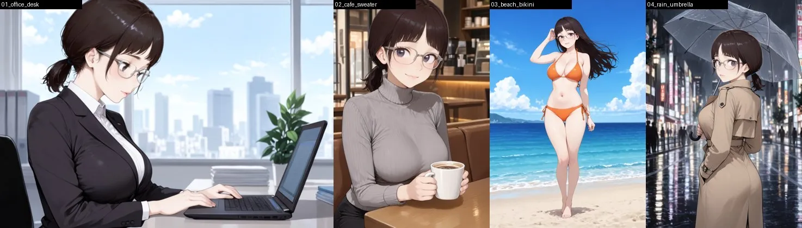

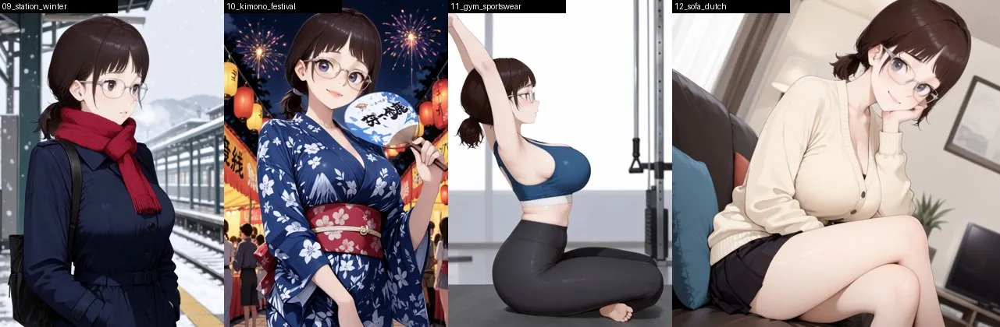
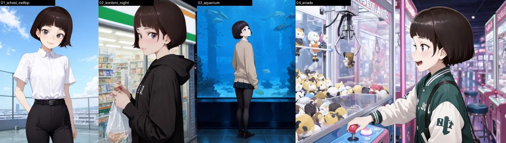
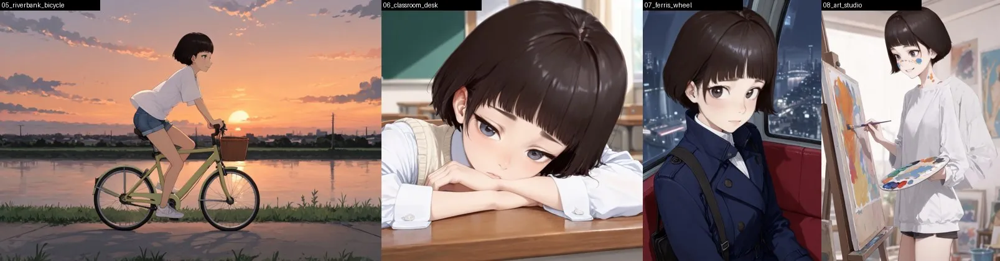
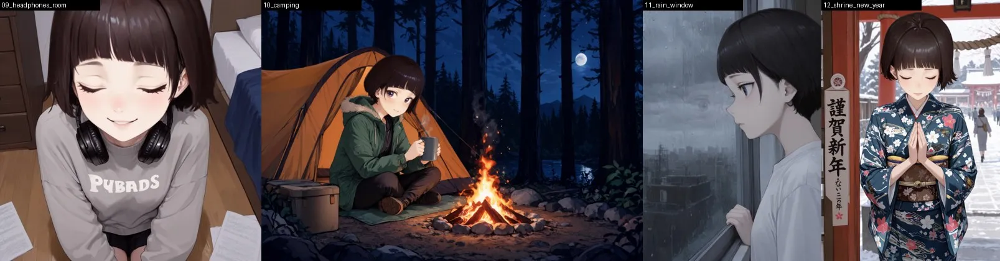

### 結果

- オフィス、雨の夜の街、浴衣、トレンチコート、キャンプ、初詣の着物など、学習に無い場面・服装でもキャラの特徴は保たれた。24 枚中 22 枚が良好だった。
- 横長・縦長・正方形（1216×832 / 832×1216 / 1024×1024）のどれでも問題はなかった。
- LoRA なしの SFT と比べると、LoRA は顔・髪型・服装の再現に明確に効いていた。

失敗と気づいた点:

- **髪型が変わった**: `wind, hand on own hair` を指定したビーチの全身（natsumi 03）で、結んだ髪が長いストレートに変わり、別人寄りになった。髪型タグ（`low ponytail` など）を明示すれば安定しそうだが、未確認である。
- **横顔で特徴が弱まった**: 真横の横顔（aki 11、`from side`）で、ぱっつん前髪が描かれなかった。
- **書かなかった部分はモデルが決める**: 上はカーディガンとシャツだけを指定し、下衣は書かなかった。すると、スカートと黒タイツが付いた（aki 03）。
- **意図しない文字**: うちわ（natsumi 10）やスウェット（aki 09）に、意味のない文字が出た。一方、指定した `謹賀新年`（aki 12）は読めた。

## 実験 2: JSON レイアウトで 2 人

左上原点のピクセル座標で下書きを書き、公式の形式（`abs_centralized` / `yxyx`）に変換した。各人物は別々の `object` item にした。caption は「トリガー, 外見の特徴, 服装, 位置, 動作」の順で書いた。下書きと変換は [`experiment/layouts.py`](experiment/layouts.py)、実際のプロンプトは [`experiment/prompts.tsv`](experiment/prompts.tsv) にある。

```
kutara natsumi, 1girl, dark brown hair in a low ponytail with blunt bangs, glasses, grey eyes, large breasts, wearing a grey ribbed turtleneck sweater, sitting on the right, gentle smile, holding a coffee cup with both hands
```

`summary.meta` は `["illustration"]` か `["poster"]` にした。下の画像は、生成画像に枠を重ねたものである（緑が object、赤が text）。

| カフェで向かい合う | 映画ポスター |
|---|---|
| 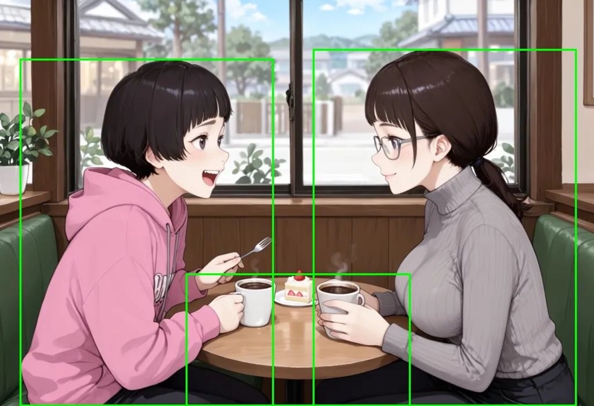 | 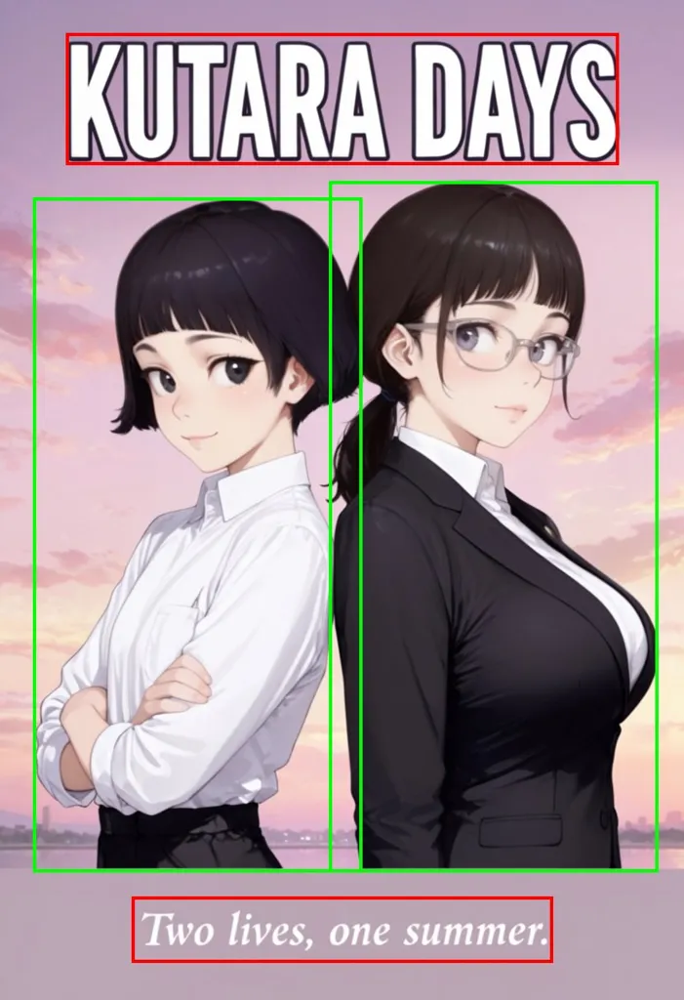 |
| **公園のベンチ** | **教室の黒板** |
| 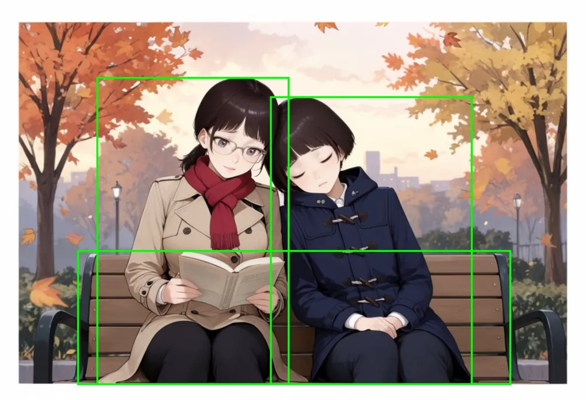 | 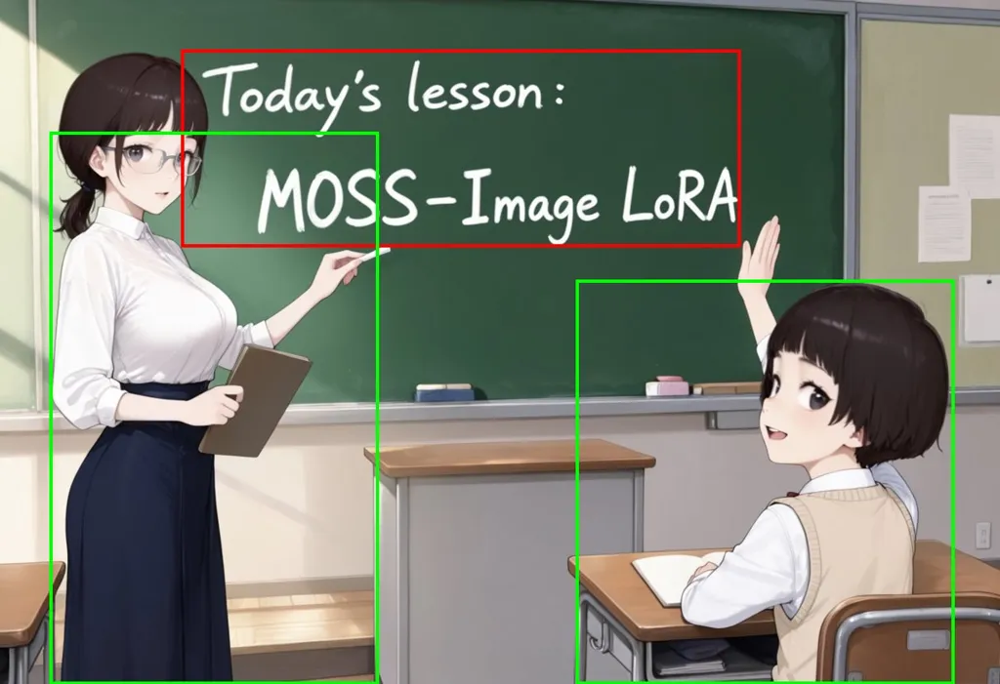 |

### 結果

- **4 枚とも 2 人の特徴が混ざらなかった。** 眼鏡と結んだ髪は natsumi だけに、ボブは aki だけに描かれた。
- 人物の位置・大きさはおおむね枠どおりだった。枠から少しはみ出すことはある。
- 関係の指定（背中合わせ、肩にもたれて眠る、先生が指して生徒が手を挙げる）も再現された。
- `text` item は 4 枚とも正確だった。`KUTARA DAYS`（太字のタイトル）、`Two lives, one summer.`（イタリックのタグライン）、`Today's lesson:\nMOSS-Image LoRA`（黒板のチョーク文字。`\n` どおり 2 行）である。
- **公園の場面で、指定していない白いフチが画像のまわりに付いた。**

## 追加確認（2026-10-21）

スキルを書く際に、次の 3 点を確かめた。下書き JSON と生成スクリプトは [`experiment/followup/`](experiment/followup/) にある。変換には、スキルの [`compile_layout.py`](../../../skills/moss-prompt/scripts/compile_layout.py) を使った。出力は公式と同じ空白なしの JSON で、実験 2 の JSON（区切りに空白あり）とは書式だけが違う。

1. **モジュール名での指定**: `--text-encoder qwen3.5_9b_bf16.safetensors --vae flux2-vae.safetensors` で生成できた。
2. **白いフチ**: 公園の場面を seed 303（実験 2 と同じ）/ 305 / 306 で生成した。上段がそのまま、下段が `summary.caption` の末尾に `The illustration fills the entire canvas edge to edge, with no white border or margin.` を足したものである。フチは上段の seed 303 でだけ出て（上下に約 40 px）、下段では出なかった。人物の頭が枠の上にはみ出すことは、文の有無にかかわらず seed 305 でも起きた。

   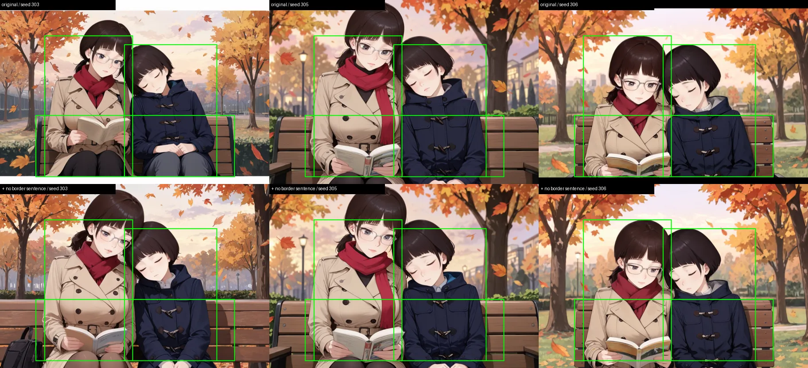

3. **`character` label**: カフェの場面（seed 301）で、人物の item の label を `character` にした。2 人の特徴は混ざらず、位置も枠どおりだった。コーヒーカップが 1 つ多く描かれた。

   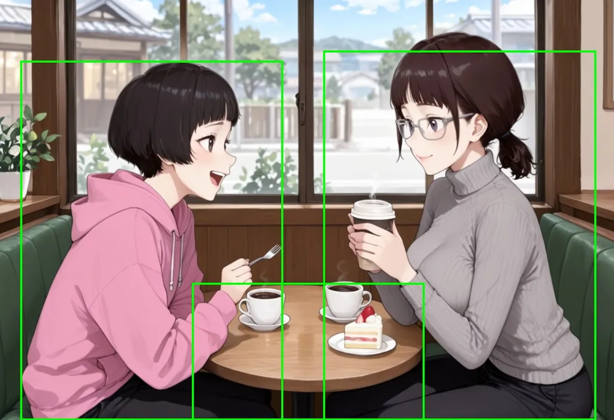

## 未検証のこと

- タグ列だけで 2 人を出したときとの比較
- 3 人以上のレイアウト
- キャラ LoRA なしの自然文キャプション
- 公式推奨のネガティブ（`nsfw, worst quality, bad anatomy, watermark, jpeg artifact`）を入れたとき
- CFG を 3 より上げたとき
- MOSS-Image-Base での結果
- 白いフチが出る条件（1 場面 1 seed でしか出ていない）
